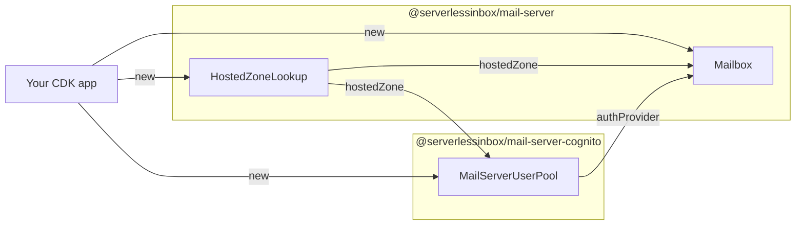

# ServerlessInbox CDK constructs

AWS CDK constructs for [ServerlessInbox](https://github.com/serverlessinbox/serverlessinbox), a
serverless JMAP email server for AWS, built for teams that already run on AWS and want email to
complete their stack. The constructs provision the whole server in your account: the JMAP, admin and
blob APIs, the admin and webmail frontends, mail receiving and sending on SES, and DNS automation.

> **Beta.** ServerlessInbox is in beta and is provided as is, without warranty (see
> [LICENSE](LICENSE)).
>
> **Issues and questions** go to the [ServerlessInbox repository](https://github.com/serverlessinbox/serverlessinbox),
> the single entry point for the whole product. Issues are not tracked in this repository.

## Install without CDK

To deploy the standard mailbox from a pre-built CloudFormation template, follow
[Deploy via CloudFormation](https://docs.serverlessinbox.com/tutorials/install-mail-server-standard/).
It lists the template parameters and the post-deploy steps, and starts from a Route53 hosted zone for
your domain.

## Install with CDK

You need an AWS account, Node.js 24 and the
[AWS CDK CLI](https://docs.aws.amazon.com/cdk/v2/guide/getting_started.html).

```sh
npm install @serverlessinbox/mail-server @serverlessinbox/mail-server-cognito \
  @serverlessinbox/artifact-registry-cdk aws-cdk-lib constructs
```

A minimal stack, with a Cognito user pool as the authentication provider and your Route53 hosted
zone serving the domain:

```typescript
import { Stack, StackProps } from 'aws-cdk-lib';
import { Construct } from 'constructs';
import { HostedZoneLookup, Mailbox } from '@serverlessinbox/mail-server';
import { MailServerUserPool } from '@serverlessinbox/mail-server-cognito';

export class MyStack extends Stack {
  constructor(scope: Construct, id: string, props?: StackProps) {
    super(scope, id, props);

    const zone = new HostedZoneLookup(this, 'HostedZone', {
      hostedZoneId: 'Z0123456789ABCDEFGHIJ',
    });

    const authProvider = new MailServerUserPool(this, 'UserPool', {
      domain: { kind: 'cognito-auto', hostedZone: zone.hostedZone },
    });

    new Mailbox(this, 'Mailbox', { hostedZone: zone.hostedZone, authProvider });
  }
}
```

## How the packages fit together



The app looks up your hosted zone, creates a `MailServerUserPool` in it and passes the pool to the
`Mailbox` as its `authProvider`.

## Packages

| Package | Description |
|---------|-------------|
| [`@serverlessinbox/mail-server`](packages/mail-server/) | The `Mailbox` construct: the JMAP email server and everything around it |
| [`@serverlessinbox/mail-server-cognito`](packages/mail-server-cognito/) | Cognito user pool as the sign-in provider of a `Mailbox`, plus the user-management API for it |

## Contributing and architecture

- [CONTRIBUTING.md](CONTRIBUTING.md): the packages, where things live, the rules to follow, recipes
  for common changes and the checks to run.
- [docs/architecture.md](docs/architecture.md): the construct tree, the stacks, the zones, the request
  paths and how Lambda code is resolved.

## Where to look

| Question | Where |
|----------|-------|
| How do I create a mailbox in my own stack? | [`packages/mail-server/src/mail-server.ts`](packages/mail-server/src/mail-server.ts) and its props in [`packages/mail-server/src/mail-server-props.ts`](packages/mail-server/src/mail-server-props.ts) |
| How do I sign users in? | [`packages/mail-server-cognito/src/user-pool/`](packages/mail-server-cognito/src/user-pool/) |
| Which Lambdas, tables, queues and state machines exist? | [`packages/mail-server/src/resources/`](packages/mail-server/src/resources/), one file per resource |
| Where is a feature such as email, auth or the APIs assembled? | [`packages/mail-server/src/core/`](packages/mail-server/src/core/) |
| How does the mailbox update itself? | [`packages/mail-server/src/platform/`](packages/mail-server/src/platform/) |
| Where is the code that runs inside the TypeScript Lambdas? | `src/runtime/` of [`mailbox`](packages/mail-server/src/runtime/), `src/runtime/` of [`mail-server-cognito`](packages/mail-server-cognito/src/runtime/) |
| Where are the architecture and the contribution rules? | [`docs/architecture.md`](docs/architecture.md), [`CONTRIBUTING.md`](CONTRIBUTING.md) |
| What changed between releases? | [`CHANGELOG.md`](CHANGELOG.md) |

## Documentation

Guides, tutorials and reference: [docs.serverlessinbox.com](https://docs.serverlessinbox.com)

## License

Apache 2.0, see [LICENSE](LICENSE).
